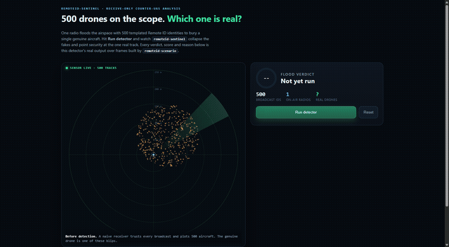

# remoteid-web

**One drone hides inside a flood of hundreds of fake Remote ID broadcasts. Press a button and watch a receive-only detector pull the real one out of the noise, in your browser, with no radio.**



### [Open the live demo](https://mattbusel.github.io/drone-demos/)

Everything runs in the tab as WebAssembly. No server, no network call after the page loads, and no transmit path.

## What it does

Press one button and the page builds a spoofing flood: hundreds of spec-compliant Remote ID broadcasts with a single real drone hidden among them. It decodes every broadcast the way a receiver would, runs the detector over the decoded tracks, and points at the one real track with the ordered reasons it was chosen. It is a thin WebAssembly shell over three real crates running unchanged, so every number on the screen comes from the same code that runs in those crates' own tests: the decoding follows ASTM F3411 / EN 4709-002 Remote ID, the flood is spec-compliant message streams encoded into memory, and the detector is receive-only. Nothing is ever broadcast, no figures are invented, and there are no fake users or telemetry.

The three crates behind it:

- [`remoteid`](https://github.com/Mattbusel/remoteid) decodes each broadcast (ASTM F3411 / EN 4709-002 Remote ID) and grades it per unit.
- [`remoteid-scenario`](https://github.com/Mattbusel/remoteid-scenario) builds the flood: spec-compliant Remote ID message streams written to memory. Data only.
- [`remoteid-sentinel`](https://github.com/Mattbusel/remoteid-sentinel) is the receive-only field analyzer: over the decoded tracks it grades how badly the airspace is flooded and ranks the one track most likely to be the real aircraft.

## Hard boundary: analysis only

This demo opens no radio, talks to no device, and has **no transmit path**. The "fake broadcasts" are spec-compliant Remote ID messages encoded into memory and fed straight back into the decoder, exactly as the underlying crates do in their own tests. Nothing is ever broadcast. The detector is receive-only: it reads broadcasts a sensor has already decoded and returns a verdict, never a frame.

## What you see

- A scope showing the flood: a dense cluster of fake tracks (they all claim one operator position, which is itself a detection signal) and one real drone that flies its own path out of the cluster, highlighted with its reasons.
- A verdict panel: the flood level and confidence, the real track that was found with the ordered reasons it was chosen, and a histogram of the cross-track signatures that mark the rest as fake (templated serials, shared operator position, tight RSSI and position cluster, sudden count spike, and so on).

Every number comes from the real crates run on the generated frames.

## Run it locally

The page is a set of static files in [`dist/`](dist/). Because it loads a WebAssembly module as an ES module, it needs to be served over HTTP (opening `index.html` from the filesystem will not work). Any static server does:

```sh
cd dist
python -m http.server 8000
# then open http://localhost:8000/
```

Deploy by serving `dist/` from any static host. No build step is required to run it; the built WebAssembly and JavaScript are committed.

## Rebuild the WebAssembly

Requires the `wasm32-unknown-unknown` target and the `wasm-bindgen` CLI at the same version as the `wasm-bindgen` crate pinned in `Cargo.toml`.

```sh
rustup target add wasm32-unknown-unknown
cargo install wasm-bindgen-cli --version 0.2.129

cargo build --release --target wasm32-unknown-unknown
wasm-bindgen --target web --no-typescript \
  --out-dir dist --out-name remoteid_web \
  target/wasm32-unknown-unknown/release/remoteid_web.wasm
```

`src/lib.rs` exposes a single `run_demo(fake_count)` function that returns the JSON summary the page renders. `dist/app.js` loads the module and draws the result; it is the only hand-written JavaScript.

## License

MIT OR Apache-2.0.
